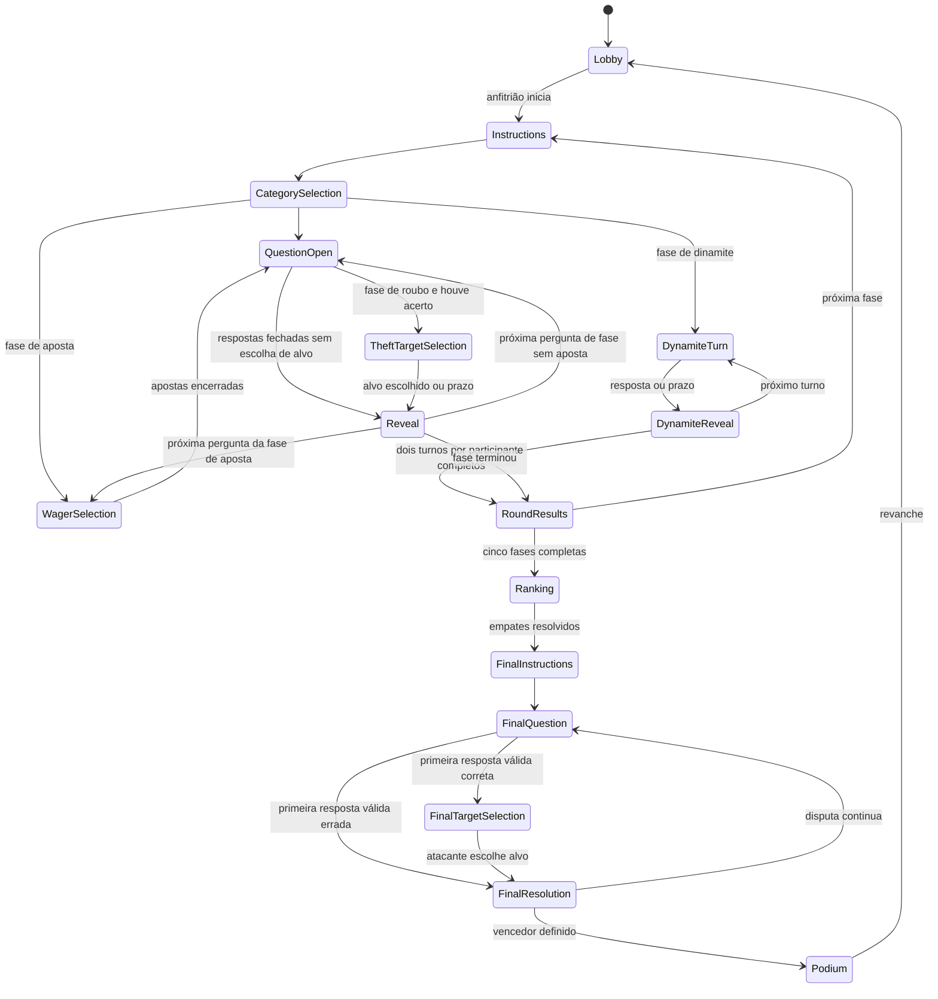

# Arquitetura planejada

Base: [análise do Comicle](analise-comicle.md). Os três pacotes já têm uma base executável, descrita em [desenvolvimento](desenvolvimento.md). A estrutura de módulos abaixo continua sendo o destino da implementação; os módulos de jogo serão criados nas tarefas correspondentes.

Parâmetros de partida, pontuação e duração vêm do [plano do jogo](plano-do-jogo.md). A [T13](pontuacao-e-parametros.md) concentra os padrões experimentais tipados em `modules/scoring/match-rules.ts` e os congela por partida, separados das regras confirmadas da final. Seleção e cálculos usam essa mesma configuração.

O [backlog de implementação](tasks/README.md) distribui a arquitetura em 35 tarefas e contém as convenções comuns de código, verificação e revisão. As [decisões](decisoes.md) registram os formatos ainda em consulta; sua ausência de resposta não deve acoplar nem interromper módulos independentes.

## Organização

```text
apps/web/src/
  features/       profile, avatar, home, lobby, match, results
  stores/         session, profile, room
  lib/            http, socket, storage, time-sync
  strings/        pt-BR
  ui/             componentes de interface
apps/server/src/
  modules/
    guest-identity/  sessões anônimas
    rooms/          membros, anfitrião, reconexão, fila por sala
    matches/        máquina da partida e orquestração
    rounds/         estratégias das modalidades
    questions/      seleção, histórico e repositório privado
    scoring/        placar e desempate
    final/          vidas, danos e eliminação
    views/          projeções por participante
  platform/       http, realtime, clock, scheduler, random
packages/shared/src/
  domain/         tipos públicos
  schemas/        validação dos comandos e respostas
  avatar/         catálogo
data/questions/   conteúdo privado do servidor e candidatos editoriais
e2e/              testes entre navegadores
```

Manter TypeScript estrito, React, Vite, Zustand, Fastify, Socket.IO e Zod. A base já usa esses pacotes com versões verificadas e lockfile próprio. A [interface](interface.md) implementa stores de sessão/perfil/sala, navegação e componentes acessíveis. O estilo provisório usa CSS nativo; Tailwind pode ser adotado quando houver necessidade. Reavaliar compatibilidade ao introduzir dependências e não copiar o lockfile do outro projeto.

## Responsabilidades

- Domínio puro: recebe estado, comando, instante e aleatoriedade explícitos; devolve novo estado e efeitos. Não conhece HTTP, socket ou banco.
- Serviços: executam cada mutação na fila da sala, tratam efeitos, agendam prazos e publicam projeções.
- Handlers: validam os contratos compartilhados, identificam a sessão e chamam os serviços.
- Interface: exibe a visão recebida e envia intenções por ações das stores. Placar, gabarito e vidas são calculados no servidor.
- Estratégias de fase: implementam validação da configuração, abertura, resposta, resolução e encerramento. Final tem domínio próprio porque troca pontos por vidas.
- Conteúdo: só registros revisados são elegíveis. A seleção é sem reposição na partida e equilibrada por categoria e dificuldade.

`modules/scoring/scoring.domain.ts` contém os cálculos puros de crédito/débito, aposta, transferência, acertos, variações e resolução por pergunta. Retorna snapshots e efeitos explicativos sem acessar transporte, tempo global ou estado compartilhado. O [motor](motor-de-partida.md) ordena recibos na fila e confirma cada resolução uma vez. `StrategyRegistry` concentra clássico, velocidade, aposta e os protótipos de [roubo](roubo.md) e [dinamite](dinamite.md), instalados somente em desenvolvimento/teste. A aposta guarda escolhas privadas antes do enunciado. O roubo mantém resolução pendente até alvo ou prazo, quando acrescenta somente a transferência. A dinamite fixa ordem de turnos sorteada, inverte o segundo ciclo e autoriza apenas o dono, com prazo individual completo. D05 e D04 continuam pendentes antes de consolidar suas variantes.

## Máquina de estados proposta

A [T22](classificacao-e-vidas.md) acrescenta classificação e conversão puras, separadas da pontuação por pergunta. O motor guarda o resumo público `finalEntry` ao encerrar os planos isolados de teste. Pontos/acertos ficam históricos; vidas prontas são imutáveis na mesma partida. Empates ficam pendentes de D06, e políticas experimentais exigem seleção explícita no domínio. A interface da final e a sequência completa continuam nas etapas posteriores.

A [T23](final-no-servidor.md) conecta `modules/final` à mesma fila e agendamento de partida, usando a conversão já congelada. O início manual do protótipo por `final:start` exige classificação pronta e estoque suficiente. A primeira resposta válida ocupa a oportunidade antes da avaliação, e cada pergunta respondida confirma uma perda por erro ou ataque manual. A final encerra por único sobrevivente; ausência de conteúdo não cria campeão. D02/D03 suspendem explicitamente o teste sem fallback. As telas continuam na T24.



Seleção de alvo, apostas e desempates acrescentam subestados somente nas modalidades que os usam. O caminho direto de categoria para pergunta pertence às fases sem aposta nem turno exclusivo. Na fase de aposta, cada nova pergunta passa por `WagerSelection`; na dinamite, apenas o dono do turno envia resposta. Instruções e seleção de tema têm prazos próprios; o relógio de resposta começa quando as alternativas ficam disponíveis, após a leitura do enunciado. Timers antigos levam ID de partida, fase e pergunta e são ignorados após transição.

Na final, a primeira resposta válida fecha as tentativas para todos dentro da fila da sala, antes da avaliação do gabarito. Se estiver errada, aplicar uma perda ao autor; se estiver certa, entrar na escolha de alvo, acessível apenas ao autor, e aplicar uma perda ao adversário escolhido. Não aguardar respostas dos demais nem reabrir a mesma pergunta após um erro. Prazo sem resposta e ausência de escolha do alvo ainda precisam de regra antes da implementação.

## Contratos compartilhados e transporte planejado

Os schemas e tipos públicos estão implementados em `@penshow/shared`, descritos no [protocolo realtime](protocolo-realtime.md) e no [modelo de dados](modelo-de-dados.md). Saúde, `time:sync` e [sessões de convidado](sessoes.md) estão em execução. O [servidor](servidor.md) compõe Socket.IO e handlers, com relógio, agendador, IDs, sorteio e tokens injetáveis. O [serviço de salas](salas.md) implementa membros, anfitrião, fila e ciclo de vida, conectado aos seis comandos `room:*`. Autorização é revalidada dentro da fila. Reconexão recupera a associação pela sessão; saída, expulsão e fechamento emitem `room:removed`. A [T15](quiz-classico.md) conecta cinco comandos de partida ao agregado da T14 e às projeções individuais somente em desenvolvimento/teste. Produção permanece sem o protótipo curto; a interface de jogo pertence à T16.

HTTP: sessão de convidado, verificação de sessão e saúde do serviço.

Socket planejado, com envelopes já contratados: `room:create`, `room:join`, `room:leave`, `room:updateProfile`, `room:updateSettings`, `room:kick`, `match:start`, `round:ready`, `category:choose`, `answer:submit`, `wager:submit`, `target:choose`, `match:returnToLobby`, `time:sync`.

Todo comando de partida informa `matchId`, `roundId`, `questionId` quando aplicável e `actionId`. O servidor valida fase, associação à sala, prazo, permissão e unicidade. Repetir `actionId` não reaplica efeitos; usar um novo `actionId` também não permite responder duas vezes à mesma pergunta.

Na final, `answer:submit` disputa uma única resposta aceita por pergunta entre todos os participantes ativos; respostas posteriores recebem indicação de pergunta já fechada e não alteram vidas. `target:choose` só é permitido ao autor da primeira resposta correta, contra outro jogador ainda ativo, e resolve uma única perda de vida. Reconexão e reenvio não restauram a oportunidade nem duplicam o dano.

Saídas: confirmação com resultado/erro e `room:view` com estado completo projetado, `stateVersion` e `serverNow`. O cliente descarta versões anteriores da mesma sala e aplica uma fotografia atual após reconectar.

Visão pública de pergunta aberta: ID, tema, enunciado, opções com IDs opacos e prazo. Nunca incluir `correctOptionId`, explicação que revele resposta, escolhas alheias, perguntas futuras ou sequência de sorteio antes do momento permitido. Embaralhar opções por pergunta no servidor sem codificar a posição correta no ID. Gabarito e resolução são enviados somente após fechar os comandos daquele período.

## Dados e persistência

Começar com salas e sessões em memória e catálogo local de perguntas revisadas carregado pelo servidor. Isso preserva a simplicidade e permite jogar sem banco externo. `data/questions` não pertence a `public/` nem pode ser importado pelo bundle web.

A publicação de T10 separa candidatos, revisados e `published/catalog.json`. O artefato tem manifesto e atribuições embutidos, é substituído após validação completa e é conferido antes de aceitar requisições. `QuestionRepository` expõe consultas privadas em memória, com cópias e disponibilidade por tema/dificuldade. Os scripts usam os mesmos schemas privados do leitor, sem colocar tipos editoriais em shared. A T11 fornece 72 perguntas aprovadas, com 12 por tema e revisão factual rastreável. O Vite também bloqueia acesso a arquivos editoriais/servidor por `/@fs` no desenvolvimento.

A [T12 implementa a seleção](selecao-de-perguntas.md) em `modules/questions/`: snapshot local, equivalências editoriais, histórico sem reposição, estoque por dificuldade e UUIDs públicos com alternativas embaralhadas. A fila de temas conserva pendentes e atendidos para continuar na revanche. O orçamento completo experimental reserva 50 perguntas e só oferece escolhas que mantêm viável o restante das fases; o protótipo clássico exige apenas sua mistura 3/3. Esgotamento interrompe sem vencedor. A T14 guarda um checkpoint privado da seleção junto ao agregado, executa mutações em rascunho na fila da sala e confirma conteúdo e placar juntos. Timers são cancelados e revalidados por contexto antes de novas transições; projeções saem após o commit.

PostgreSQL e Drizzle permanecem uma opção coerente com o Comicle quando houver necessidade de histórico, edição de conteúdo ou recuperação após reinício. Sua adoção depende desse requisito; o armazenamento de imagens e histórias do Comicle não será necessário.

Configurações e chaves do PENSHOW devem ser próprias: `penshow.profile`, `penshow.session`, `penshow.sound` e base de URL/socket independente. Configurar `/penshow/` somente quando a hospedagem for definida. Conservar o catálogo de avatar no pacote compartilhado porque ele é conteúdo público.

## Verificação da implementação

A [T25](podio-e-revanche.md) agrega o histórico liquidado em resumos públicos por fase somente no encerramento. A web apresenta o pódio já derivado das vidas e a classificação anterior como histórico. O retorno ao lobby passa pelo serviço, descarta o agregado/timers e conserva apenas a fila privada de escolha de temas para o seletor da próxima partida. A lista de participantes é reconstruída com saídas explícitas e promoção de espectadores até a capacidade; perfis e identidade da sala permanecem.

Testes unitários para transições, pontuação, atribuição de vidas, perda por erro e escolha de alvo, com relógio e sorteio determinísticos. Integração para autorização, ações repetidas, prazos, serialização e reconexão. Na final, testar duas respostas concorrentes, a primeira errada seguida de uma correta rejeitada, ataque único e tentativas de escolher alvo sem ter acertado. Testes de projeção verificam ausência de gabaritos e dados privados em todas as fases e para espectadores.

Playwright valida criar/entrar, personalizar, duas sessões, cinco fases, final, pódio e revanche, além de celular e queda do anfitrião. Validar que `/comicle/` e `/penshow/` não compartilham identidade nem socket por acidente.
