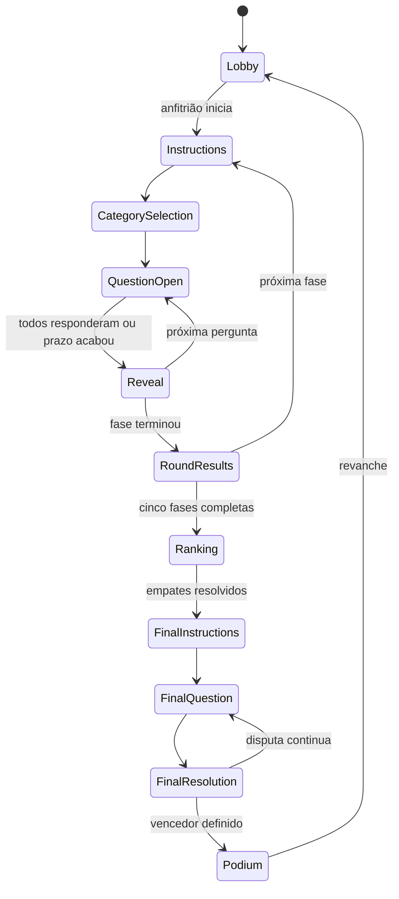

# Arquitetura planejada

Base: [análise do Comicle](analise-comicle.md). Esta estrutura é o destino da implementação; os diretórios de aplicação ainda não foram criados.

## Organização

```text
apps/web/src/
  features/       profile, avatar, home, lobby, match, results
  stores/         session, profile, room
  lib/            http, socket, storage, time-sync
  strings/        pt-BR
  ui/             componentes de interface
apps/server/src/
  modules/
    guest-identity/  sessões anônimas
    rooms/          membros, anfitrião, reconexão, fila por sala
    matches/        máquina da partida e orquestração
    rounds/         estratégias das modalidades
    questions/      seleção, histórico e repositório privado
    scoring/        placar e desempate
    final/          vidas, danos e eliminação
    views/          projeções por participante
  platform/       http, realtime, clock, scheduler, random
packages/shared/src/
  domain/         tipos públicos
  schemas/        validação dos comandos e respostas
  avatar/         catálogo
data/questions/   conteúdo privado do servidor e candidatos editoriais
e2e/              testes entre navegadores
```

Manter TypeScript estrito, React, Vite, Tailwind, Zustand, Fastify, Socket.IO e Zod. Reavaliar versões na implementação e gerar lockfile próprio. Não copiar cegamente o lockfile do outro projeto nem declarar que dependências ainda não instaladas foram verificadas.

## Responsabilidades

- Domínio puro: recebe estado, comando, instante e aleatoriedade explícitos; devolve novo estado e efeitos. Não conhece HTTP, socket ou banco.
- Serviços: executam cada mutação na fila da sala, tratam efeitos, agendam prazos e publicam projeções.
- Handlers: validam os contratos compartilhados, identificam a sessão e chamam os serviços.
- Interface: exibe a visão recebida e envia intenções por ações das stores. Placar, gabarito e vidas são calculados no servidor.
- Estratégias de fase: implementam validação da configuração, abertura, resposta, resolução e encerramento. Final tem domínio próprio porque troca pontos por vidas.
- Conteúdo: só registros revisados são elegíveis. A seleção é sem reposição na partida e equilibrada por categoria e dificuldade.

## Máquina de estados proposta



Seleção de alvo, apostas e desempates acrescentam subestados somente nas modalidades que os usam. Instruções e seleção de tema têm prazos próprios; o relógio de resposta começa quando a pergunta abre. Timers antigos levam ID de partida, fase e pergunta e são ignorados após transição.

## Contratos previstos

HTTP: sessão de convidado, verificação de sessão e saúde do serviço.

Socket: `room:create`, `room:join`, `room:leave`, `room:updateProfile`, `room:updateSettings`, `room:kick`, `match:start`, `category:choose`, `answer:submit`, `wager:submit`, `target:choose`, `match:returnToLobby`, `time:sync`.

Todo comando de partida informa `matchId`, `roundId`, `questionId` quando aplicável e `actionId`. O servidor valida fase, associação à sala, prazo, permissão e unicidade. Repetir `actionId` não reaplica efeitos; usar um novo `actionId` também não permite responder duas vezes à mesma pergunta.

Saídas: confirmação com resultado/erro e `room:view` com estado completo projetado, `stateVersion` e `serverNow`. O cliente descarta versões anteriores da mesma sala e aplica uma fotografia atual após reconectar.

Visão pública de pergunta aberta: ID, tema, enunciado, opções com IDs opacos e prazo. Nunca incluir `correctOptionId`, explicação que revele resposta, escolhas alheias, perguntas futuras ou sequência de sorteio antes do momento permitido. Embaralhar opções por pergunta no servidor sem codificar a posição correta no ID. Gabarito e resolução são enviados somente após fechar os comandos daquele período.

## Dados e persistência

Começar com salas e sessões em memória e catálogo local de perguntas revisadas carregado pelo servidor. Isso preserva a simplicidade e permite jogar sem banco externo. `data/questions` não pertence a `public/` nem pode ser importado pelo bundle web.

PostgreSQL e Drizzle permanecem uma opção coerente com o Comicle quando houver necessidade de histórico, edição de conteúdo ou recuperação após reinício. Sua adoção depende desse requisito; o armazenamento de imagens e histórias do Comicle não será necessário.

Configurações e chaves do PENSHOW devem ser próprias: `penshow.profile`, `penshow.session`, `penshow.sound` e base de URL/socket independente. Configurar `/penshow/` somente quando a hospedagem for definida. Conservar o catálogo de avatar no pacote compartilhado porque ele é conteúdo público.

## Verificação da implementação

Testes unitários para transições, pontuação, atribuição de vidas e dano simultâneo, com relógio e sorteio determinísticos. Integração para autorização, ações repetidas, prazos, serialização e reconexão. Testes de projeção verificam ausência de gabaritos e dados privados em todas as fases e para espectadores.

Playwright valida criar/entrar, personalizar, duas sessões, cinco fases, final, pódio e revanche, além de celular e queda do anfitrião. Validar que `/comicle/` e `/penshow/` não compartilham identidade nem socket por acidente.
