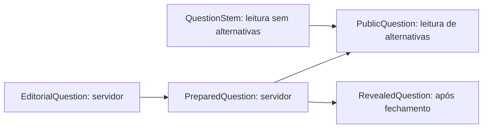

# Modelo de dados e fronteiras

Os contratos públicos validados, transporte, dependências injetáveis, sessões de convidado e salas em memória com comandos autenticados estão disponíveis. A publicação editorial e o leitor privado do catálogo também estão implementados; a T11 fornece 72 perguntas aprovadas em pt-BR. O [motor da T14](motor-de-partida.md) integra seleção, pontuação e projeção com confirmação atômica; a [T15](quiz-classico.md) conecta o quiz clássico à rede em desenvolvimento/teste, com progresso e conclusão de uma fase. As mensagens estão no [protocolo](protocolo-realtime.md), a infraestrutura em [servidor](servidor.md), identidade em [sessões](sessoes.md) e domínio interno em [salas](salas.md).

## Localização e exposição

| Camada | Local | Conteúdo disponível |
|---|---|---|
| Contratos públicos | `packages/shared/src/schemas/` | Perfis, membros, configurações, fases, placar, vidas, comandos, erros, confirmações e visões |
| Regras confirmadas/consultas | `packages/shared/src/domain/rules.ts` | Constantes imutáveis da final e registro D01–D06 |
| Tipos editoriais e privados | `apps/server/src/modules/questions/question.ts` | `EditorialQuestion`, `ApprovedQuestion`, `PreparedQuestion` e procedência/revisão |
| Candidatos existentes | `data/questions/candidates/` | 1.531 registros editoriais; nenhum aprovado automaticamente |
| Sessões privadas | `apps/server/src/modules/guest-identity/` | Registro em memória com ID, hash e prazo; um vínculo ativo por identidade |
| Salas internas | `apps/server/src/modules/rooms/` | Registro em memória, membros/conexão privada, fila, anfitrião e roster congelado do limite de quiz |
| Projeção e publicação | `apps/server/src/modules/views/` | Construção explícita de `RoomView` por membro e publicação para sua conexão atual; remoção por saída, expulsão ou fechamento |
| Revisão e catálogo privado | `data/questions/reviewed/`, `data/questions/published/catalog.json` | Registros editoriais e artefato com manifesto, perguntas aprovadas e atribuições; lote inicial de 72 aprovadas na T11 |
| Leitura de perguntas | `modules/questions/question.repository.ts`, `platform/local-question.repository.ts` no server | Porta de leitura, filtros de tema/dificuldade e disponibilidade em memória |
| Seleção privada | `modules/questions/question-selection.ts` e auxiliares no server | Estoque, reserva, fila de temas, histórico, perguntas e IDs opacos; checkpoint privado confirmado com o motor |
| Pontuação e configuração | `modules/scoring/` no server | Parâmetros congelados, cálculos puros e histórico; resolução clássica confirmada uma vez pelo motor |
| Motor de partidas | `modules/matches/` no server | Máquina pura, registro de estratégias, serviço na fila, timers por contexto e projeções; composição de rede em T15 |

Shared não importa apps ou dados editoriais e não exporta tipos privados, mapa de alternativas, fonte de sorteio de perguntas nem registros do catálogo editorial. O catálogo público de avatares e a porta de sorteio de aparência fazem parte de shared. A lista de exports públicos está em `packages/shared/src/index.ts`. O manifesto marca suas declarações de schema como livres de efeitos externos, permitindo remover contratos não utilizados do bundle web.

## Identificadores e limites técnicos

`PlayerId`, `RoomId`, `MatchId`, `RoundId`, `QuestionId`, `OptionId` e `ActionId` são marcas distintas na tipagem, validadas como UUIDv4 no JSON. Marcas não substituem autorização e não validam a existência da entidade. IDs editoriais (`fonte:tema:hash`) pertencem somente ao servidor; não são IDs de pergunta pública.

| Dado | Limite estrutural |
|---|---|
| Apelido | Entrada de até 256 unidades UTF-16; saída de 1 a 20 pontos de código após NFC, trim e compactação de espaços; sem controles/Cf |
| ID de peça de avatar | Até 64 caracteres, presente na própria categoria do catálogo público; obrigatórias não admitem null |
| Código de sala | Seis caracteres maiúsculos, sem I/O/0/1 |
| Tema | Slug minúsculo, até 64 caracteres |
| Enunciado/explicação | Até 2.000 unidades UTF-16, texto não vazio após trim; explicação pode ser nula |
| Texto de alternativa | Até 500 unidades UTF-16, não vazio |
| Capacidade de jogadores | De 2 a 12 no formato experimental |
| Temas habilitados | De 1 a 32, sem repetição |
| Opções de tema em uma escolha | De 1 a 4, sem repetição |
| Membros na fotografia | Até 100, incluindo espectadores; orçamento técnico, não meta de capacidade do jogo |
| Placar/finalistas | De 2 a 12 participantes únicos |
| Valores de aposta oferecidos | De 1 a 16 valores distintos, incluindo zero |
| Efeitos em uma revelação | Até 120; orçamento técnico para uma fotografia |
| Pontos, acertos, versões e timestamps | Inteiros seguros não negativos |

Esses limites protegem os contratos. T03 configura limites de corpo HTTP e mensagem Socket.IO; limites específicos de requisições e política de espectadores serão ampliados em T28. A capacidade proposta de 2–12 permanece identificada como experimental; não é evidência de teste de grupo.

## Perfil, papéis e presença

`PlayerProfile` contém apenas `nickname` e `avatar`. Avatar tem peças obrigatórias `head`, `eyes`, `mouth` e peças anuláveis `cheeks`, `faceAccessory`, `hat`. O catálogo e as 50 artes foram migrados da [definição do Comicle no commit analisado](https://github.com/ninguemdev/Comicle/tree/4521f34df78da7de54a30715d50e748c50aa0696/packages/shared/src/avatar), com [licença preservada](../THIRD_PARTY_NOTICES.md). O schema público valida a pertinência de cada ID à sua categoria, inclusive nos comandos recebidos pelo servidor. Recuperação tolerante de perfis antigos pertence apenas à leitura local: `sanitizeAvatar` preserva as partes válidas e substitui as demais pelos padrões. O protocolo rejeita IDs inválidos em vez de saneá-los silenciosamente. Detalhes em [avatares](avatares.md).

`RoomMember.role` distingue `player` e `spectator`. `isHost` é independente do papel de participante, mas um espectador não pode ser anfitrião neste formato. Conexão é uma união entre `{ status: "connected" }` e `{ status: "disconnected", since }`; não expõe socket ID, endereço, sessão ou token.

Uma fotografia de sala aberta tem membros únicos, inclui o destinatário (`viewerId`), respeita a capacidade e tem exatamente um anfitrião. Durante a partida, membros com papel `player` correspondem à lista congelada do placar. Novas entradas são espectadores; desconexões conservam os participantes na fotografia. Eliminação na final fica em `Finalist.status` e não remove o membro ou o placar histórico.

## Configuração e modalidades

`RoomSettings` contém `format: "prototype-v1"`, `maxPlayers` e `enabledCategories`. Não permite habilitar catálogo candidato, escolher gabaritos ou declarar uma configuração aprovada. A [T13](pontuacao-e-parametros.md) implementa os parâmetros completos de pontuação/tempo e seu congelamento em `FrozenMatchRules`, privado do servidor. A configuração separa `parameters` experimentais, `confirmedFinal` e `pendingDecisions` e está vinculada ao `matchId`.

`Round` é discriminado por `mode`, com posição coerente e ID próprio:

| `mode` | `index` | Tratamento |
|---|---:|---|
| `classic` | 1 | Quiz clássico |
| `speed` | 2 | Velocidade |
| `wager` | 3 | Aposta |
| `theft` | 4 | Roubo; política de elegibilidade segue D05 |
| `pressure` | 5 | Variante `{ status: "pending", decisionId: "D04" }` ou dinamite explicitamente `{ status: "prototype", decisionId: "D04", mode: "dynamite" }` |
| `final` | 6 | Núcleo confirmado da final |

Uma modalidade em outra posição é rejeitada. O formato não fornece defaults para consultas. A quinta fase pode aparecer como pendente nas instruções/escolha de tema, mas não abrir perguntas sem uma variante experimental explícita. A dinamite experimental exige um respondente individual; as outras fases de pontuação usam todos os participantes.

`MatchStage` também representa `prototype-complete`, com a última `ScoringRound`, para encerrar explicitamente o plano experimental executado. Essa etapa não contém ranking, vidas ou vencedor. O serviço da T14 prepara somente a fase clássica; os demais schemas continuam contratos para suas tarefas futuras.

`MatchView.progress` informa `roundNumber`, `roundCount`, `questionNumber` e `questionCount`, todos inteiros seguros, com contagens positivas e posições dentro dos limites. Antes da primeira pergunta, `questionNumber` é zero; durante leitura, resposta ou revelação é a posição atual. O quiz clássico publica uma fase e seis perguntas. A conclusão exige a última fase e todas as perguntas; uma pergunta aberta não pode ter posição zero.

`PENDING_DECISIONS` conserva D01 a D06 em `in-consultation`. As propostas estão em [decisões](decisoes.md); registrá-las não transforma duração, dinamite, primeiro acerto no roubo, fallback de alvo ou sorteio residual em regra aprovada.

## Três representações de pergunta

`EditorialQuestion` preserva o formato dos importadores: ID determinístico, tema, idioma, tipo, enunciado, alternativas com IDs editoriais, gabarito, dificuldade, status e procedência. A união distingue candidatos/rejeitados de `approved`. `ApprovedQuestion` exige pt-BR, dificuldade revisada (`easy`, `medium`, `hard`), referência HTTP(S), data de revisão válida e `checks` com `factual`, `language` e `uniqueAnswer` explicitamente verdadeiros. Esses tipos agora são inferidos dos schemas privados, evitando divergência entre scripts e leitor.

O validador privado é reutilizado por `scripts/lib/questions.mjs`. A publicação lê `reviewed/`, compara a origem com o candidato/manifesto e escreve um artefato determinístico separado, substituído somente após validação completa. O repositório local confere esquema, gabarito, revisão, atribuições, duplicatas, disponibilidade e hashes antes de aceitar requisições. A declaração de revisão não prova a verdade do conteúdo; as decisões factuais das 72 perguntas iniciais estão no [relatório da T11](revisao-editorial-t11.md). Detalhes e comandos em [perguntas](perguntas.md).

`PreparedQuestion` contém `publicQuestion`, `editorialQuestionId`, o mapa privado `editorialOptionByPublicId`, `correctOptionId` público associado ao gabarito e `explanation`. O mapa relaciona cada UUID público ao ID editorial da alternativa e nunca é serializado para o cliente. `QuestionSelection` implementa a construção explícita, o embaralhamento e os IDs pelas portas injetadas; guarda a preparação para devolver a mesma pergunta após reconsulta e retorna cópias independentes.

`PublicQuestion` contém somente `questionId`, `category`, `locale: "pt-BR"`, `type`, `prompt`, `difficulty` e `options`. Cada opção contém apenas `optionId` e `text`. `multiple` exige quatro opções; `boolean` exige duas, sem converter automaticamente uma pergunta de quatro alternativas. IDs e textos normalizados das alternativas precisam ser distintos. Não aceita `unrated`.

O seletor usa `IdGenerator` para pergunta/opções e `RandomSource` para embaralhar. A composição de produção fornece UUIDv4 criptográficos e `randomInt`; os IDs não usam posição, dificuldade ou acerto. IDs editoriais, colisões e UUIDs inválidos são recusados. O schema impede IDs como `option-0`; **o formato UUID, sozinho, não comprova aleatoriedade nem ausência de codificação do gabarito**. A preparação e o mapa privado são testados na seleção; a futura projeção da partida ainda precisa preservar essa fronteira.

`QuestionStem` contém os mesmos metadados da pergunta, sem opções; é usado durante leitura. Aposta mostra somente ID, tema e dificuldade, sem enunciado ou alternativas. `RevealedQuestion` contém `question`, `correctOptionId` correspondente a uma opção pública e explicação anulável; somente aparece após fechar respostas.

Schemas públicos rejeitam campos extras em todos os níveis. Não são funções de projeção: passar um objeto privado para `publicQuestionSchema` deve falhar. `buildMatchView` constrói a lista permitida antes de validar: enunciado na leitura, alternativas/resposta própria na abertura, gabarito/explicação/efeitos na revelação. Não enviar um objeto privado com uma propriedade escondida ou confiar apenas em uma coerção de tipos.

## Visões de sala e de partida

`RoomView.state.status` distingue:

- `lobby`: configurações e membros, sem estado privado de partida.
- `match`: configurações, membros e `MatchView` com `matchId`, `rulesVersion`, placar e `stage`.
- `closed`: motivo (`expired`, `no-players`, `server-shutdown`).

`MatchStage.phase` discrimina as fotografias completas. Não permite usar payload de uma fase em outra:

| Fase | Dados específicos |
|---|---|
| `instructions` | Fase de pontuação, prazo, jogadores prontos |
| `category-selection` | Fase de pontuação, responsável, temas e prazo |
| `question-reading` | Fase de pontuação, enunciado sem opções e instante de abertura |
| `wager-selection` | Fase de aposta, ID/tema/dificuldade, valores oferecidos, prazo e aposta própria |
| `question-open` | Fase de pontuação, pergunta pública, abertura/prazo, quem respondeu, resposta própria e respondentes |
| `theft-target-selection` | Fase de roubo, ID da pergunta, atacante, alvos e prazo; não inclui gabarito |
| `reveal` | Fase de pontuação, pergunta revelada, efeitos explicativos e prazo |
| `round-results` | Fase de pontuação e prazo; o placar fica em `MatchView` |
| `ranking` | Classificação pendente de D06 ou resolvida |
| `final-instructions` | Fase final, finalistas com vidas iniciais, prontos e prazo |
| `final-question-reading` | Finalistas, enunciado sem opções e abertura |
| `final-question-open` | Finalistas, pergunta pública, abertura/prazo, `answerPolicy: "first-valid-only"` |
| `final-target-selection` | Finalistas, pergunta já revelada, uma resposta correta aceita, todos os adversários ativos e prazo |
| `final-resolution` | Finalistas, revelação, uma resolução por erro/ataque e prazo |
| `podium` | Finalistas e posições em ordem de sobrevivência/eliminação |
| `interrupted` | Motivo, sem campeão inventado (`insufficient-questions`, `no-players`, `room-closed`) |

`ownAnswer` e `ownWager` distinguem `unavailable`, `pending` e `submitted`, com opção/valor somente no último caso. São dados individuais do destinatário. O schema de sala impede fornecer resposta própria a espectador ou a quem está fora do turno, verifica a correspondência com a confirmação pública e impede aposta própria acima do saldo ou fora das opções oferecidas. Não existe uma lista de alternativas escolhidas ou apostas alheias em perguntas abertas.

O schema verifica referências a participantes, fase/modalidade, progresso, unicidade, janelas e invariantes locais; não executa transições ou cálculo oficial. `buildPlayerView` reconstrói campos públicos do lobby e delega o jogo a `buildMatchView`, com versão/instante da sala por destinatário. Não membro ou partida legada sem agregado recebe `null`. Os testes da T15 verificam participantes, anfitrião e espectador em todas as etapas clássicas, incluindo resposta própria recuperada após reconexão e ausência de campos editoriais.

`RoomRemoved` contém somente `roomId`, `stateVersion` e `reason` (`left`, `kicked` ou `closed`), validado por schema estrito e discriminado em `serverEventSchema`. O publicador usa esse evento para encerrar a associação, inclusive no fechamento, sem enviar uma fotografia terminal redundante. Não expõe lista de banidos, motivo privado ou ID de socket e não invalida a sessão. No cliente, sala e versão precisam corresponder à visão atual antes de removê-la.

## Placar, classificação e vidas

`ScoreEntry` contém `playerId`, `points` e `correctAnswers`. Os valores são inteiros seguros não negativos; não há campo de anfitrião ou ordem de conexão para desempate. `ScoreEffect` distingue crédito e débito, com quantidade não negativa e motivo. Explica o resultado ao cliente; não calcula pontos, transfere saldo nem autoriza apostas.

O domínio privado da T13 executa esses cálculos em `resolveQuestion`, usando configuração congelada e recibos autoritativos. `QuestionScoreResolution` contém contexto, modalidade, placares antes/depois, IDs que acertaram, efeitos compatíveis com `ScoreEffect` e variações por participante. `ScoringHistory` reúne os registros e a configuração daquela partida. Não há estado global, mutação da entrada ou cálculo oficial no cliente. Aplicação única, fechamento da pergunta, autorização e publicação serão integrados pelo motor e serviços. Shared exporta os aliases inferidos `Scoreboard`, `ScoringRound` e `ScoringMode`, sem funções de pontuação.

`Ranking.status` é `pending-tiebreak`, referenciando D06 e os saldos congelados, ou `resolved`, com participantes únicos, posições consecutivas e pontos decrescentes. A visão conserva os valores do placar. Não seleciona um desempate residual nem presume vidas iguais; o motor só publicará `resolved` depois de resolver a política aplicável.

As regras confirmadas estão em `CONFIRMED_FINAL_RULES`, congeladas em execução:

| Posição | Vidas iniciais | Perdas às quais sobrevive |
|---|---:|---:|
| 1 | 5 | 4 |
| 2 | 4 | 3 |
| 3 | 3 | 2 |
| 4 em diante | 2 | 1 |

`Finalist.status` discrimina `active` (de 1 até suas vidas iniciais) de `eliminated` (zero vidas e `eliminationOrder`). A atribuição inicial é validada contra a posição, as posições são únicas/consecutivas e uma final tem ao menos um sobrevivente. Nas instruções todos começam ativos com suas vidas iniciais; em perguntas/escolha de alvo ainda há ao menos dois ativos. O pódio exige um único sobrevivente e a ordem inversa de eliminações.

`FinalResolution.outcome` distingue `wrong-answer` de `attack`. Erro tem um único autor, a alternativa errada e `damage: 1` contra esse autor; ataque tem a alternativa correta do único autor aceito, outro participante como alvo e `damage: 1`. Não há array de respostas aceitas ou vários danos. Escolha de alvo exige que o autor esteja ativo e tenha acertado e que a lista elegível contenha **todos** os outros ativos, inclusive desconectados.

Essa estrutura expressa R05/R07/R08. A conversão e o dano oficiais serão executados no servidor, uma única vez, nas tarefas correspondentes. Validar uma fotografia não comprova o histórico de perdas, a prioridade temporal ou a deduplicação de efeitos. D02/D03 continuam isoladas: não há política padrão de pular pergunta ou atacar automaticamente.
