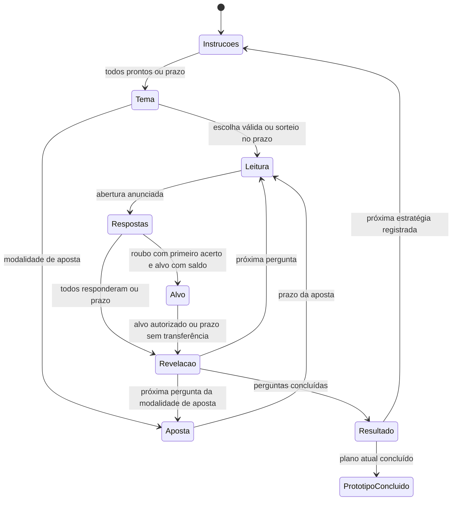

# Motor comum da partida

A T14 implementa o motor interno em `apps/server/src/modules/matches/`. Ele compõe a seleção da T12 e os cálculos da T13 na fila existente da sala. A [T15](quiz-classico.md) instala o serviço e os handlers em `app.ts` somente em desenvolvimento/teste, com integração de sessões Socket.IO reais. A [T16](quiz-classico-web.md) conecta início e telas aos estados/comandos autoritativos. D01–D06 continuam em consulta.

## Estado e estratégia

`createMatch` copia o elenco, perfis, configurações e plano de fases; valida cada modalidade no `StrategyRegistry` e congela as regras experimentais do `matchId`. O agregado guarda revisão, placar e histórico de resoluções. A sala recusa mudanças no elenco, regras ou plano durante a mesma partida.

`transitionMatch` recebe estado, evento e instante explícitos e devolve novo estado e solicitações de conteúdo. Não lê relógio global, sorteia IDs, instala timers ou chama transporte. O registro fornece a resolução da modalidade por um contrato pequeno; clássico, velocidade, aposta e os protótipos de [roubo](roubo.md) e [dinamite](dinamite.md) são instalados pelo serviço. D05 e D04 continuam pendentes para consolidar suas variantes. A [final de teste](final-no-servidor.md) tem domínio próprio, conectado à mesma fila; D02/D03 continuam pendentes.

O ciclo executável é:

`awaiting-category` e `awaiting-question` são etapas intermediárias da transação. O serviço resolve seus efeitos antes de confirmar a sala; elas nunca são publicadas. `prototype-complete` encerra somente o plano experimental atual, sem produzir classificação, vidas ou vencedor. A interrupção por conteúdo insuficiente também termina sem vencedor.

O serviço prepara planos isolados de clássico (três fáceis/três médias), velocidade (duas fáceis/três médias/uma difícil), aposta/roubo (duas por dificuldade) ou dinamite (uma média e uma difícil por participante), pelos parâmetros padrão. A escolha é congelada no início; o formato omitido mantém clássico. O motor puro aceita planos de estratégias registradas; o serviço ainda não prepara a sequência completa.

Na aposta, cada `question-prepared` limpa as apostas anteriores e abre `wager-selection` antes do enunciado. O agregado guarda `SealedWager[]` privado com o saldo original, sem desconto. O prazo integral de seis segundos encerra a escolha; ausência vale zero. Leitura e resposta seguem o ciclo comum. A estratégia recebe as apostas da pergunta, e a resolução aplica base/aposta ou perda uma única vez. Repetição da mesma escolha é no-op; alteração produz `ACTION_CONFLICT`. As visões expõem somente a própria aposta até a revelação e recuperam o mesmo valor na reconexão.

No protótipo de roubo, fechar respostas calcula e confirma os créditos de acerto antes da escolha. A resolução pendente fica em `theft-target-selection`; `settleTarget` acrescenta somente débito/crédito de transferência sobre esse resultado, e a revelação guarda um único histórico completo. Sem alvo no prazo, finaliza a resolução base. Primeiro acerto vem da ordem dos recibos, ignorando erros anteriores; respostas ainda abertas não expõem autor ou pontos. O prazo e a escolha sobrevivem à reconexão sem recalcular créditos.

Na dinamite, `pressureOrder` guarda a permutação sorteada pelo serviço, independente do anfitrião e da ordem de respostas. O histórico determina o índice do turno; `pressureTurn` alterna ordem direta/inversa por ciclo. O dono é enviado à estratégia junto das opções da resolução; quem está fora do turno recebe `FORBIDDEN` antes de registrar resposta. Um recibo do dono encerra o turno; timeout resolve ausência. A leitura seguinte anuncia nova janela integral, e nenhuma explosão remove participantes ou transfere tempo restante. As projeções publicam apenas turno atual/próximo, sem a escala completa.

Ao concluir o plano isolado, a [T22](classificacao-e-vidas.md) guarda `finalEntry` junto de `prototype-complete`. O escopo público é `isolated-prototype`: o resumo classifica e atribui 5/4/3/2 vidas quando os pontos definem a ordem, ou registra pendência D06 sem vidas. O motor não inicia a final nessa etapa. A conversão pronta não muda em transações posteriores da mesma partida, e a projeção/reconexão apenas recupera o retrato. Acertos e políticas residuais continuam em APIs experimentais explícitas do domínio puro.

A T23 acrescenta `final:start` para continuar esse protótipo, pelo anfitrião, quando a classificação está pronta e há conteúdo suficiente. `MatchState.final` guarda o domínio separado de vidas. `transitionMatch` encaminha eventos e timers para `transitionFinal`; a preparação de conteúdo continua no serviço, com checkpoint e rollback. A primeira resposta válida fecha a oportunidade antes de avaliar o gabarito. Erro e ataque manual confirmam um único dano e histórico; a pergunta seguinte não recalcula a perda. Um sobrevivente produz `podium`; esgotamento interrompe sem campeão por pontos. Prazos D02/D03 entram em pendência sem dano. A projeção usa progresso sem total fixo de perguntas e conserva a conversão inicial.

## Transação, prazos e falhas

`MatchSession` guarda o agregado e um `SelectionCheckpoint` privado em `RoomPhase`. `QuestionSelection.resume` clona o grafo do checkpoint, preservando os vínculos internos de mapas/conjuntos. Seleção, cursor de pergunta, respostas, resolução e placar são confirmados juntos por `Room.runExclusive`. Uma exceção descarta todo o rascunho; a fila continua aceitando operações.

Checkpoints são apenas memória interna confiável: não constituem formato público nem persistência para reinício. As portas de IDs e sorteio ficam fora do snapshot. Uma tentativa que falha pode consumir entropia/IDs, mas não consome conteúdo ou altera o estado confirmado.

O ator vem da autenticação. O serviço revalida conexão atual, papel e associação na execução da fila e mede o recebimento pelo relógio injetado nesse momento. A janela aceita `opensAt <= receivedAt < deadlineAt`; o prazo exato já está encerrado. Uma resposta por participante é definitiva. Repetir prontidão é uma operação sem alteração; respostas repetidas são rejeitadas e não reaplicam pontos.

A resolução consulta a estratégia uma vez ao fechar a pergunta e guarda placares anterior/atual e efeitos no mesmo commit. O histórico impede resolver novamente o mesmo `questionId`. Não há reaplicação independente dos efeitos de crédito: a projeção lê o placar já confirmado.

Depois do commit, `QuizLifecycle.committed` cancela o timer anterior e agenda o próximo antes de o observador publicar as visões. O timer inclui sala por referência, `matchId`, `roundId`, `questionId`, revisão, etapa e prazo. O callback entra novamente na fila e compara todo o contexto, inclusive sua identidade de agendamento. Cancelamento físico e checagem lógica protegem contra callbacks já em trânsito.

Presença/reconexão não renovam o timer da partida. O prazo de abertura anunciado na leitura continua sendo a origem da janela de resposta quando o callback atrasa; se a janela inteira já passou, a pergunta é resolvida por ausência. A revelação inclui `revealMs + transitionMs` antes da próxima leitura. Retorno ao lobby, fechamento e conclusão cancelam o timer de partida.

Falha de conteúdo/cálculo antes do commit mantém o estado anterior; um timer tenta o mesmo contexto novamente após um segundo, enquanto ainda for atual. Novos comandos válidos continuam na mesma fila. Falha do observador depois do commit é reportada sem desfazer o placar; o próximo timer já foi instalado. Esse tratamento pressupõe o funcionamento das portas de relógio/agendamento; não oferece recuperação após reinício do processo.

## Projeção e limite de rede

`buildMatchView` constrói campos permitidos e valida o resultado com `matchViewSchema`. Leitura contém apenas o enunciado; abertura contém alternativas, progresso e somente a escolha do próprio destinatário. Espectador recebe `ownAnswer: unavailable`. Gabarito, explicação e efeitos aparecem na revelação. Checkpoint, fontes, IDs editoriais, mapa de alternativas, recibos e perguntas futuras nunca são publicados.

`buildPlayerView` incorpora esse resultado quando a sala tem um motor instalado. Validadores legados sem agregado continuam retornando `null` na fase de partida. A publicação usa o observador existente, com versão única da sala após cada mutação aceita. `prototype-complete` é uma extensão aditiva da união pública `MatchStage`, com a última fase de pontuação e sem pódio.

`app.ts` compõe `MatchService({ runtime, questions, isCurrentActor })` fora de produção, fornece como `quiz` ao `RoomService` e mantém `onChange` com o publicador existente. `match.handlers.ts` encaminha ações autenticadas por `matches.execute(room, actor, command)` e adapta os acks específicos. O retorno público exige conclusão ou interrupção; o retorno interno do ciclo de salas conserva a possibilidade de cancelamento. A T15 também projeta contagens de fase/pergunta em `MatchView.progress`.

## Verificação

`match.domain.test.ts` cobre transições, imutabilidade, prontidão repetida, autorização/contexto, prazo exato, callbacks atrasados, todos responderam, ausência, efeitos em ordem, histórico único, interrupção, término e passagem para outra estratégia fornecida somente pelo teste.

`match.service.test.ts` usa salas reais em memória, catálogo sintético aprovado, seleção efetiva, relógio/agendador manuais e projeções validadas. Cobre seis perguntas distintas, concorrência, cancelamento no lobby/fechamento, callback de partida anterior, rollback após consumo de conteúdo, falha de cálculo, nova tentativa do timer, falha de publicação, conexão substituída e privacidade por destinatário. Evidências de execução estão na [T14](tasks/T14-motor-comum-de-partida.md).
