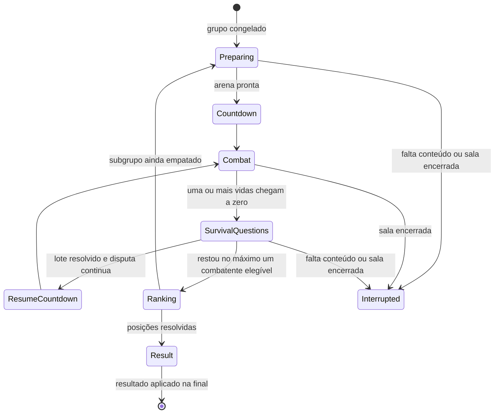

# Plano de implementação do desempate de tiro

Plano da [T39](tasks/T39-desempate-tiro-top-down.md), elaborado em 23/10/2026 a partir do código existente. O desenho original abaixo foi implementado em desenvolvimento/teste; o [guia da entrega](desempate-tiro.md) registra os arquivos efetivos, escolhas e limites, e a T39 registra as verificações executadas. O status permanece no [índice de tarefas](tasks/README.md). Nomes de arquivos apresentados como planejados abaixo não são prova de existência.

## Resultado esperado

Quando dois ou mais participantes perderem a última vida do quiz na mesma resolução, a final identifica um grupo empatado e abre um minigame de tiro 2D top-down apenas para esse grupo. Cada participante começa com três vidas. Ao chegar a zero, recebe uma pergunta: erro elimina; acerto devolve uma vida e permite continuar. O resultado ordena as colocações do grupo, sem alterar as posições já conquistadas pelos demais.

O desempate integra a quinta fase. Não acrescenta uma sexta fase, não usa pontos como vidas e não devolve o vencedor ao quiz por suposição. O formato clássico e a hospedagem por último permanecem conforme [decisões](decisoes.md).

## Regras confirmadas e escolhas do protótipo

São decisões do usuário: disparo por eliminação simultânea, combate 2D top-down, três vidas iniciais, pergunta ao chegar a zero, eliminação por erro e recuperação de uma vida por acerto. A recuperação pode acontecer novamente a cada chegada a zero. Empate de pontos/acertos antes da final segue D06: vidas iguais e posições consecutivas por grupo, sem iniciar combate.

Para tornar o plano executável, adotar as escolhas iniciais abaixo como parâmetros e políticas de protótipo, separados das regras confirmadas. Não exigem interromper as frentes independentes para pedir aprovação; registrar mudanças e validar sua compreensão e equilíbrio com pessoas.

| Tema | Escolha inicial de implementação |
|---|---|
| Momento do desempate | Pausar o quiz após resolver a perda coletiva e executar o grupo imediatamente; sobreviventes do quiz e demais membros assistem |
| Resultado do grupo | Último sobrevivente do combate ocupa a melhor posição disponível para aquele grupo; os demais seguem a ordem inversa de eliminação definitiva no combate |
| Sem sobreviventes no quiz | O vencedor do grupo final é o campeão da partida; manter suas vidas de quiz em zero e registrar a origem da vitória no resultado |
| Grupo abaixo do campeão | Se um jogador do quiz sobrevive e os outros são eliminados juntos, ele conserva o 1º lugar; o combate decide do 2º em diante |
| Pergunta de sobrevivência | Ao haver uma ou mais vidas zeradas no mesmo passo da simulação, pausar toda a arena, retirar projéteis em voo e preparar uma pergunta privada distinta para cada participante desse lote |
| Respostas do lote | Abrir as perguntas do lote em paralelo; ninguém retoma o combate até todas serem resolvidas. Não declarar vitória enquanto houver resposta pendente |
| Conteúdo | Perguntas médias entre os temas habilitados, com alternativas embaralhadas e sem repetição na partida; usar o mesmo nível em todo o lote |
| Prazo da pergunta | Leitura reservada conforme duração da narração, com mínimo já usado pelo quiz; depois 15 segundos de resposta e 3 de revelação. Ausência no prazo equivale a erro neste protótipo |
| Retorno ao combate | Acerto devolve exatamente uma vida; reposicionar em ponto livre de reaparecimento, aplicar um segundo de proteção e uma contagem coletiva de retomada |
| Proteção | Durante a proteção o participante não recebe dano nem pode atirar; durante pergunta, leitura, revelação e contagem ninguém se move ou atira |
| Novo empate no próprio combate | Eliminações definitivas do mesmo lote formam um subgrupo empatado. Resolver esse subgrupo em novo combate, com três vidas iniciais, sem reabrir posições dos demais |
| Todos eliminados no mesmo lote | Reabrir combate apenas entre o último grupo empatado; não escolher campeão por chegada da resposta, identidade ou ordem da conexão |

Congelar esses parâmetros por partida junto das regras. Não impor limite de recuperações ou de perguntas para forçar um vencedor. Caso falte conteúdo, interromper de forma explícita, preservando o histórico já confirmado e sem inventar classificação completa.

## Integração com a final e o pódio

1. Implementar a resolução coletiva D02 na T23 como uma operação: capturar vidas anteriores, aplicar todas as perdas, formar o lote dos que chegaram a zero e registrar uma única resolução.
2. Diferenciar perda de vida de eliminação. Se três jogadores perderem uma vida e só um chegar a zero, não há desempate. Se dois chegarem a zero, apenas esses dois entram no grupo.
3. Criar `eliminationBatchId` e congelar participantes, resolução de origem e intervalo de posições ainda indefinidas. Não atribuir `eliminationOrder` diferente a mortes da mesma resolução.
4. Pausar o avanço do quiz, inclusive se restar um único sobrevivente, até registrar as posições do grupo. Depois, retomar a próxima pergunta se houver pelo menos dois ativos; com um, fechar o pódio; com zero, usar o vencedor do grupo como campeão.
5. Registrar separadamente vidas do quiz, vidas de combate e classificação final. O campeão por desempate pode ter zero vidas no quiz; isso é um resultado válido, não um motivo para recriar vidas.
6. Ao terminar um combate, guardar lotes de eliminação e vencedor. Se algum lote continuar empatado, abrir um subcombate apenas para ele; usar fila explícita e resolver um combate por vez, sem recursão infinita na pilha.
7. Não publicar pódio completo antes de resolver todos os intervalos empatados. Reaplicar o resultado do mesmo `tiebreakId` é uma operação sem efeito, nunca uma segunda classificação.

Exemplos de aceite:

| Situação | Resultado esperado |
|---|---|
| A tem duas vidas; B e C têm uma; ninguém responde | A fica com uma vida; B e C disputam 2º/3º no minigame; A conserva o 1º |
| A, B e C têm uma vida; ninguém responde | Os três entram no minigame; seu vencedor ganha a partida; o resultado do combate resolve o grupo |
| A tem três vidas; B tem duas; C tem uma; ninguém responde | Apenas C é eliminado; não abrir combate; A e B continuam o quiz |
| Dois combatentes chegam a zero no mesmo passo | Ambos recebem perguntas; só após as respostas resolver retorno com uma vida, eliminações e eventual novo empate |
| Um combatente tem uma vida e outro responde à pergunta | Não declarar vitória do primeiro enquanto a pergunta do segundo estiver pendente |

## Aproveitamento do código e mudanças necessárias

| Ponto existente | Mudança planejada |
|---|---|
| `modules/final/final.domain.ts` | Resolver dano coletivo, registrar lotes e efeitos de abertura/conclusão do desempate; preservar primeira resposta exclusiva e ataque manual |
| `packages/shared/src/schemas/score.ts` | Substituir a suposição de posições individuais únicas e ao menos um ativo em todos os estados por invariantes por etapa; permitir zero ativos quando houver desempate ou resultado válido |
| `packages/shared/src/schemas/view.ts` | Acrescentar resolução coletiva, estados do desempate e classificação final explícita; separar sobrevivente do quiz de campeão por combate |
| `modules/final/build-final-view.ts` | Parar de derivar todo pódio exclusivamente de `active` e `eliminationOrder`; projetar a classificação já resolvida e os grupos pendentes |
| `modules/matches/match.domain.ts` e `match.service.ts` | Integrar efeitos, checkpoints, contexto e ciclo de vida do combate à sessão, sem criar uma partida ou fase extra |
| `modules/questions/question-selection.ts` | Acrescentar seleção de perguntas de sobrevivência por lote e proprietário; o seletor atual mantém uma única pergunta final corrente e não atende lotes paralelos |
| `modules/rooms/room.ts` | Conservar `runExclusive` como ponto de serialização; diferenciar commits de quadro de combate e transições que exigem visão completa |
| `platform/traffic-policy.ts`, `app.ts` e `platform/realtime/dispatcher.ts` | Acrescentar orçamento próprio para controles contínuos, preservando autenticação, validação, limites de pendências e o orçamento dos comandos de quiz |
| `apps/web/src/lib/socket.ts` e stores | Suportar entrada contínua e quadros compactos; hoje o transporte espera confirmação por comando e recebe a visão completa da sala |
| `features/match/final-round.tsx` e `features/results/podium.tsx` | Encaminhar à arena e mostrar resultado de combate, sem confundir vidas de tiro com vidas de quiz ou exigir campeão com status `active` no quiz |

Os caminhos acima existem no repositório. Os arquivos novos propostos abaixo ainda não existem:

| Local planejado | Responsabilidade |
|---|---|
| `apps/server/src/modules/tiebreak/tiebreak.domain.ts` | Transições puras, vida, perguntas, eliminação e resultado |
| `apps/server/src/modules/tiebreak/combat.domain.ts` | Passo fixo de movimento, tiro e colisões |
| `apps/server/src/modules/tiebreak/tiebreak.service.ts` | Coordenar entradas, passos, seleção e efeitos sob a fila da sala |
| `apps/server/src/modules/tiebreak/build-tiebreak-view.ts` | Projeções públicas e pergunta privada do proprietário |
| `packages/shared/src/schemas/tiebreak.ts` | Contexto, comandos, quadros, estados e resultado |
| `apps/web/src/features/tiebreak/` | Arena Canvas 2D, controles, HUD, pergunta e resultado |
| `apps/web/src/stores/tiebreak-store.ts` | Receber quadros, descartar contexto antigo e manter intenções locais |
| `e2e/tests/tiebreak.spec.ts` | Percurso real do empate até resultado, reconexão e revanche |

Usar React, Canvas 2D e Socket.IO já presentes no projeto. Nenhum motor de jogo, serviço externo, banco ou asset gerado é necessário para a primeira versão.

## Estados e dados

`SurvivalQuestions` agrega leitura, janela de resposta e revelação; a entidade de cada participante distingue `fighting`, `awaiting-question`, `answering`, `returning` e `eliminated`. Um jogador em pergunta continua elegível ao resultado até errar ou esgotar seu prazo.

Estado privado mínimo: `tiebreakId`, partida/fase, lote de origem, grupo congelado, intervalo de posições, regras, arena, relógio da simulação, passos/entradas consumidos, combatentes, projéteis, lote de perguntas, checkpoint de seleção, lotes de eliminação, fila de subgrupos e resultado aplicado.

Usar IDs próprios para combate, subcombate e lote de perguntas. Toda entrada referencia o contexto completo e uma sequência crescente. A ordem de sequência de entrada controla obsolescência de comandos, nunca desempata mortes ocorridas no mesmo passo.

## Arena e simulação inicial

Valores abaixo são parâmetros de protótipo para medição, não decisões atribuídas ao usuário:

| Parâmetro | Valor inicial |
|---|---|
| Área lógica | 1.200 × 800 unidades; escala visual independente da resolução |
| Participantes | 2 a 12 empatados |
| Layout | Uma arena aberta com limites e quatro obstáculos retangulares simétricos |
| Personagem | Colisão circular, raio 16; nome e avatar existente do jogador |
| Movimento | 200 unidades/segundo, diagonal normalizada, bloqueio por obstáculos e bordas |
| Arma | Uma arma igual para todos; tiro reto, sem munição, troca de arma ou dano próprio |
| Projétil | Velocidade de 600 unidades/segundo, raio 4, duração máxima de 1,5 segundo |
| Cadência | No máximo um tiro a cada 300 ms, decidida pelo servidor |
| Dano | Um por projétil aceito; no máximo um dano por personagem por passo; zerar vidas uma única vez |
| Preparação/retomada | Contagem de 3 segundos; instrução inicial de até 15 segundos, com prontidão do grupo |
| Simulação | Passos fixos de 50 ms, 20 por segundo |
| Publicação de posições | Até 10 quadros compactos por segundo; eventos de dano e transição enviados imediatamente |
| Entrada do cliente | Enviar mudança e renovação de intenção, até 20 por segundo; neutralizar após 250 ms sem entrada válida |

Sortear posições iniciais entre pontos válidos e espaçados, gravando o sorteio uma vez. Se a geometria não suportar os doze participantes sem sobreposição ou obstáculo, corrigir a arena antes da integração. Calcular colisão no segmento percorrido pelo projétil, evitando atravessar alvos entre dois passos. Acumular impactos do mesmo passo antes de registrar eliminações; remover projétil no primeiro impacto válido e ignorar tiros contra autor, eliminados ou protegidos.

Tempo de combate avança apenas nos passos simulados; pausas de pergunta não consomem proteção nem cadência. Após pausa, usar nova geração de entradas e descartar intenções anteriores, exigindo entrada fresca. Não executar uma explosão de passos atrasados: limitar recuperação a cinco passos por execução e registrar atraso local; diante de atraso persistente, pausar tecnicamente e retomar com contagem, sem inventar dano durante o período não simulado.

## Rede, fila e limites

O limite atual é de **240 comandos por minuto** por orçamento configurado. Um controle a 20 entradas por segundo chegaria a 1.200 por minuto. Portanto, a arena precisa de uma classe de tráfego própria; aumentar indiscriminadamente o limite dos comandos de quiz não resolve o desenho.

- Planejar `tiebreak:input` para intenção de movimento, mira e gatilho, com contexto, sequência e geração; o jogador autenticado é derivado da conexão. Nunca aceitar posição, velocidade final, alvo atingido, dano ou vidas informados pelo cliente.
- Tratar gatilho como intenção mantida; o servidor decide cada disparo pela cadência. Reenvio de sequência não cria tiro. Renovação de intenção com nova sequência é própria de controle contínuo, distinta de repetir uma resposta.
- Aplicar limitador exclusivo de controle, inicialmente 30 entradas/segundo por conexão, com rajada limitada, mais limites de tamanho e sessão; manter o orçamento existente para quiz, sala e pergunta de sobrevivência.
- Coalescer movimento/mira: no máximo uma atualização de entrada pendente por jogador; o valor mais recente substitui o ainda não processado. Nunca descartar, coalescer ou repetir silenciosamente respostas de perguntas.
- Manter toda escrita autoritativa sob `Room.runExclusive`. O serviço agenda um passo por sala em combate, não um timer por projétil. Confirmar quadros após commit, com revisão/geração, e ignorar callback de combate encerrado.
- Planejar `tiebreak:frame` com contexto, passo, horário e posições/projéteis públicos, enviado sem confirmação e descartável quando obsoleto. Não anexar histórico completo, checkpoint editorial ou gabarito a quadros de movimento.
- Publicar `room:view` completo em entrada/saída do combate, dano/vidas, perguntas, mudança de presença e resultado. Evitar serializar e transmitir a visão inteira em cada passo. Não abandonar a transação ou a validação de estado para obter essa redução.
- Manter versões independentes para último quadro e última visão completa: receber um quadro novo não pode bloquear uma pergunta ou resultado confiável por comparação com a versão de outro canal.
- Em recarga, a visão completa inclui o quadro atual e a pergunta própria ainda aberta. Quadros recebidos antes da sincronização de contexto são ignorados. Um quadro atrasado não reabre combate encerrado nem sobrescreve resultado.

Começar com simulação e checkpoints no agregado existente. Medir custo de clonagem/validação por passo: a fila atual copia o estado da sala e contém histórico da partida. Só otimizar a estrutura interna após evidência de gargalo, mantendo estado reconstruível, isolamento entre salas e uma única autoridade.

## Perguntas e disponibilidade

Preparar o lote de perguntas na mesma transação do combate e do checkpoint editorial. Uma falha de preparação não confirma dano parcial, não consome perguntas sem registrar e não duplica recuperação na tentativa seguinte. Cada pergunta pertence a um participante/lote; os demais recebem somente o estado de espera, sem alternativas, resposta escolhida ou gabarito privado.

A janela de resposta começa após o período de leitura/narração da respectiva pergunta, com no mínimo os 15 segundos completos. A arena espera todas as perguntas, inclusive a de maior duração de narração. Cada participante recebe no máximo uma resposta aceita para aquela pergunta; vencido o prazo, registrar a eliminação uma vez. Revelação para o proprietário permite entender erro/acerto sem expor perguntas futuras.

Estender o histórico único de usados do seletor atual. Não criar um catálogo paralelo no cliente ou reutilizar a mesma pergunta para jogadores diferentes do lote. A reserva atual da final é de 50; ela não garante suporte a recuperações ilimitadas. Recalcular o estoque inicial mínimo para um lote de até doze perguntas médias, preservar capacidade para continuar o quiz quando houver sobreviventes e usar o restante inédito sob demanda. Se não houver alocação viável, interromper explicitamente sem preencher o restante do pódio por sorteio.

## Interface e ciclo de vida

Computador: WASD ou setas para mover, ponteiro para mirar e botão principal para manter tiro. Celular: área de movimento à esquerda e controle de mira/tiro à direita, com posições escaláveis e Pointer Events. Ao perder foco, ocultar a aba, cancelar ponteiro ou desconectar, neutralizar controles e soltar captura. Não capturar teclas de combate em campos ou botões da pergunta.

Usar Canvas somente para arena, avatares e projéteis. Instruções, vidas, cronômetro, pergunta, respostas e resultado ficam em elementos HTML acessíveis. Desenhar entre os dois últimos quadros do servidor com `requestAnimationFrame`; animação não decide colisão ou vidas. Limitar extrapolação e mostrar conexão instável se faltar atualização. Guardar quadros fora do estado de renderização de cada componente React.

Participantes fora do grupo assistem à arena e ao andamento, sem controlar combatentes ou ver perguntas privadas. Sons de disparo têm volume e agrupamento para não saturar a mixagem; respeitar silêncio, movimento reduzido e as preferências existentes. A narração usa o mesmo mecanismo robótico de T37 para a pergunta do proprietário.

Queda: manter o personagem parado e vulnerável, neutralizando tiro. A pergunta já aberta conserva seu prazo; voltar não dá três vidas nem repõe tempo. Se todos desconectarem, preservar o ciclo de sala da T26: suspender novos passos/preparações, conservar prazos já abertos e encerrar sem campeão após a carência existente. A segunda aba substitui a conexão anterior e invalida suas entradas. Remover todos os timers, listeners, capturas e quadros ao encerrar combate, sair ao lobby, iniciar revanche ou fechar aplicação.

## Ordem de execução e entregas verificáveis

As unidades abaixo subdividem T39; não criam nove novos status no backlog. Cada unidade deve produzir uma alteração revisável, com critérios claros antes da seguinte.

| Unidade | Entrega | Dependência | Como considerar pronta |
|---|---|---|---|
| T39-A | Fundação de grupos e classificação | Núcleo T23, D02 e D06 aplicadas nos pontos necessários | Dano coletivo atômico, posições compartilhadas de entrada, zero ativos representável e grupos sem desempate por ordem de evento |
| T39-B | Contratos e máquina do desempate | A | Schemas aceitam estados coerentes, rejeitam contexto inválido e distinguem vidas de quiz, combate e resultado |
| T39-C | Simulação pura da arena | B | Movimento/tiro/colisão determinísticos, três vidas, impactos simultâneos, pausa e cadência cobertos com relógio controlado |
| T39-D | Perguntas de sobrevivência | B | Lote privado, seleção sem repetição, leitura/prazo completo, erro elimina e acerto devolve exatamente uma vida repetidamente |
| T39-E | Serviço, transporte e fluxo contínuo | C, D | Duas sessões reais se movem e atiram; passos e entradas limitados; callbacks e replay não duplicam efeitos; quadros não publicam gabaritos |
| T39-F | Arena e controles web | E | Jogável em computador e toque, HUD/pergunta acessíveis, espectadores sem ações e reconexão com estado preservado |
| T39-G | Grupos internos, final, pódio e revanche | A, E, F | Resolve posições do grupo e novos empates, conserva sobreviventes do quiz, campeão por combate e limpeza completa na revanche |
| T39-H | Matriz de integração e carga | G | Percursos de 2/4/12 combatentes, múltiplas salas, desktop/celular, latência, privacidade e encerramento aprovados |
| T39-I | Equilíbrio, documentação e consolidação | H | T29/T32/T36 atualizadas com evidências; avaliação humana de controles/duração preparada ou realizada com limites explícitos |

Não é necessário terminar todas as alterações de roubo/som/editorial para desenvolver o domínio isolado do combate. A validação final integrada depende das políticas de T22/T23 usadas no disparo do empate. O protótipo permanece em desenvolvimento/teste até os critérios de liberação do projeto; a VM não é dependência desta implementação.

## Matriz de validação

| Camada | Casos necessários |
|---|---|
| Domínio | Disparo por lote; dano sem negativos; um dano por passo; colisão por segmento; diagonal sem vantagem; obstáculos; cadência; proteção; todos ou parte zerando; pausa sem consumir tempo de combate |
| Perguntas | Certo/errado/ausente; fronteira exata do prazo; leituras de durações diferentes; retorno com uma vida; duas recuperações consecutivas; rejeição de resposta alheia, dupla ou de lote antigo; falta de conteúdo |
| Classificação | Sobrevivente fora do grupo; todos do quiz eliminados; três ou mais empatados; lotes empatados no próprio combate; aplicação repetida do mesmo resultado sem reordenar pódio |
| Serviço/rede | Corrida entre passo e resposta; callback cancelado; comando de aba substituída; sequência atrasada; saturação de movimento sem bloquear perguntas; reconexão durante combate e pergunta |
| Privacidade | Somente proprietário recebe pergunta; quadros não carregam gabarito/checkpoint; espectador e outra sala não comandam; versão antiga não reabre estado |
| Web/e2e | Entrada por empate real de D02; controles reais; dano; pergunta; acerto e novo dano; erro; pódio; recarga; espectadores; revanche em desktop e celular emulado |
| Carga e recursos | 2/4/12 combatentes; três salas de doze em paralelo; fila limitada; ausência de timers/listeners após encerramento; payload, tempo por passo e atraso documentados |

Metas locais iniciais para T39-H: passo de 50 ms com trabalho de processamento p95 abaixo de 25 ms por sala em máquina de referência documentada; nenhuma fila crescendo continuamente durante cinco minutos em três salas de doze; no máximo uma entrada pendente por participante e um passo agendado por arena. Medir processo, serialização e rede; esses números são critérios de protótipo a confirmar, não capacidade prometida para a futura VM.

Testes de serviço usam relógio e aleatoriedade injetados; colisões e perguntas não dependem de esperas reais. E2e usa aplicativo e transporte reais, podendo acelerar tempos pela composição de teste, sem endpoint público que force resultado. Acrescentar os cenários à CI existente após estabilizar a integração.

Ao implementar, executar os comandos existentes pertinentes: `pnpm lint`, `pnpm typecheck`, `pnpm test`, `pnpm build`, o percurso Playwright de T39 e os percursos afetados de final/modo clássico. Reexecutar relatórios de estoque e piloto quando mudarem seleção ou parâmetros; preservar relatórios anteriores como históricos. Registrar resultados realmente executados na T39, sem marcar plano ou teste escrito como validação concluída.

## Conclusão da tarefa

T39 estará concluída quando um empate real disparar o combate, todas as regras de três vidas/pergunta/recuperação funcionarem em rede, as posições do grupo forem integradas corretamente e reconexão, privacidade e limpeza estiverem verificadas. Atualizar regras, protocolo, modelo de dados, arquitetura, estoque e guias para o comportamento entregue. A publicação T35 continua por último, aguardando a VM do usuário e as demais condições de liberação.
