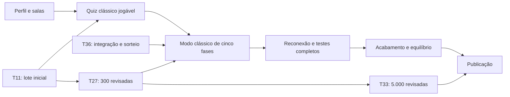

# Tarefas de implementação

Este backlog segue o formato do Comicle: índice de dependências e status, arquivo por tarefa, entregáveis verificáveis e unidades pequenas de revisão. As tarefas foram desenhadas para o PENSHOW; módulos de quadrinhos não fazem parte do escopo.

**39 tarefas planejadas.** O quadro abaixo registra o andamento real. As ferramentas de importação existentes são ponto de partida de T01/T10, não conclusão dessas tarefas.

O status de implementação fica somente neste índice. As checklists dos arquivos registram entregas e evidências.

**Decisões de 23/10/2026:** D01–D08 foram respondidas e D09 acrescentou o minigame de desempate, conforme [registro](../decisoes.md). D06 usa posições por grupo sem saltos: 5/4/3/2 vidas. T20/T21/T22/T23/T29/T36 incorporam as políticas aprovadas, com evidências na [consolidação técnica](../validation/t21-t36-t29.md). T30/T31/T32 conservam validações presenciais e T33 conserva a expansão editorial; os acréscimos da interface da final ficam registrados em T24 e integrados por T36. A T39 implementou o tiro 2D top-down com três vidas e pergunta ao chegar a zero em desenvolvimento/teste. Em 26/10/2026, o piloto foi instalado via MCP AWS/SSM na VM do Comicle e validado em [dionel.site/penshow/](https://dionel.site/penshow/), com cinco jogadores em desktop e celular emulado. As rotas Cloudflare do domínio principal estão ativas. T35 continua em andamento: partida humana completa e critérios globais permanecem pendentes. Evidências anteriores continuam históricas; as dúvidas anteriores sobre empate e faixas de vidas foram respondidas.

Legenda: ⬜ pendente · 🟨 em andamento · ✅ concluída.

## Ordem e dependências

| ID | Tarefa | Depende de | Marco | Status |
|---|---|---|---|---|
| T01 | [Bootstrap do monorepo e qualidade](./T01-bootstrap-monorepo.md) | — | M1 | ✅ |
| T02 | [Contratos compartilhados e documentação técnica](./T02-contratos-e-documentacao.md) | T01 | M1 | ✅ |
| T03 | [Servidor e infraestrutura de tempo real](./T03-servidor-base.md) | T02 | M1 | ✅ |
| T04 | [Identidade anônima e sessão](./T04-identidade-convidado.md) | T03 | M1 | ✅ |
| T05 | [Web base, interface e navegação](./T05-web-base-e-interface.md) | T02 | M1 | ✅ |
| T06 | [Perfil, nomes e editor de personagens](./T06-perfil-e-avatares.md) | T05 | M1 | ✅ |
| T07 | [Domínio e serviço de salas](./T07-dominio-e-servico-de-salas.md) | T04 | M1 | ✅ |
| T08 | [Salas em tempo real e projeção do lobby](./T08-salas-realtime-e-projecao.md) | T07 | M1 | ✅ |
| T09 | [Início, convite e lobby](./T09-inicio-convite-e-lobby.md) | T06, T08 | M1 | ✅ |
| T10 | [Catálogo privado e publicação editorial](./T10-catalogo-e-publicacao-de-perguntas.md) | T02 | M2 | ✅ |
| T11 | [Primeiro lote de perguntas revisadas](./T11-primeiro-lote-editorial.md) | T10 | M2 | ✅ |
| T12 | [Seleção de temas, perguntas e reserva da final](./T12-selecao-de-temas-e-perguntas.md) | T10 | M2 | ✅ |
| T13 | [Pontuação pura e parâmetros de regras](./T13-pontuacao-e-parametros.md) | T02 | M2 | ✅ |
| T14 | [Motor comum da partida e das fases](./T14-motor-comum-de-partida.md) | T08, T12, T13 | M2 | ✅ |
| T15 | [Quiz clássico no servidor](./T15-quiz-classico-servidor.md) | T14 | M2 | ✅ |
| T16 | [Fluxo de perguntas e placar na web](./T16-quiz-classico-web.md) | T09, T15 | M2 | ✅ |
| T17 | [Primeiro marco jogável e smoke test](./T17-primeiro-marco-jogavel.md) | T11, T16 | M2 | ✅ |
| T18 | [Modalidade de velocidade](./T18-fase-velocidade.md) | T17 | M3 | ✅ |
| T19 | [Modalidade de aposta](./T19-fase-aposta.md) | T17, T13 | M3 | ✅ |
| T20 | [Modalidade de roubo de pontos](./T20-fase-roubo.md) | T17, T13 | M3 | ✅ |
| T21 | [Quinta fase de pressão e dinamite](./T21-quinta-fase-pressao.md) | T17, T13 | M3 | ✅ |
| T22 | [Classificação, desempates e atribuição de vidas](./T22-classificacao-e-vidas.md) | T13 | M3 | ✅ |
| T23 | [Final no servidor com primeira resposta exclusiva](./T23-final-no-servidor.md) | T14, T22 | M3 | ✅ |
| T24 | [Final na web e visualização das vidas](./T24-final-na-web.md) | T16, T23 | M3 | ✅ |
| T25 | [Pódio, histórico e revanche](./T25-podio-e-revanche.md) | T24 | M3 | ✅ |
| T26 | [Reconexão em todas as fases e ciclo de vida](./T26-reconexao-e-ciclo-de-vida.md) | T25, T18, T19, T20, T21 | M4 | ✅ |
| T27 | [Catálogo de 300 perguntas para testes completos](./T27-catalogo-de-teste-completo.md) | T11, T12 | M3 | ✅ |
| T28 | [Privacidade, limites e concorrência](./T28-privacidade-limites-e-concorrencia.md) | T26 | M4 | ✅ |
| T29 | [Testes ponta a ponta da partida completa](./T29-e2e-partida-completa.md) | T26, T27, T28, T36 | M4 | ✅ |
| T30 | [Acessibilidade, celular e acabamento visual](./T30-acessibilidade-e-responsividade.md) | T25, T18, T19, T20, T21 | M5 | 🟨 |
| T31 | [Sons e preferências do jogador](./T31-sons-e-preferencias.md) | T25, T21 | M5 | 🟨 |
| T32 | [Testes com grupos e equilíbrio](./T32-testes-de-grupo-e-equilibrio.md) | T29, T30, T31 | M5 | 🟨 |
| T33 | [Expansão para 5.000 perguntas revisadas](./T33-expansao-para-5000-perguntas.md) | T27 | M6 | 🟨 |
| T34 | [Build, container e operação de produção](./T34-build-e-operacao-de-producao.md) | T28, T29 | M6 | ✅ |
| T35 | [Publicação e validação final](./T35-publicacao-e-validacao-final.md) | T32, T33, T34, T39 | M6 | 🟨 |
| T36 | [Modo clássico padrão com cinco fases e ordem sorteada](./T36-modo-classico-padrao.md) | T18, T19, T20, T21, T25, T26, T27, T39 | M3 | ✅ |
| T37 | [Narrador robótico antes das respostas](./T37-narrador-robotico.md) | T16, T24, T31 | M5 | ✅ |
| T38 | [Efeitos sonoros simples e fluidos](./T38-efeitos-sonoros-fluidos.md) | T31, T37 | M5 | ✅ |
| T39 | [Desempate por minigame de tiro 2D top-down](./T39-desempate-tiro-top-down.md) | T23, T24, T25, T28 | M3 | ✅ |

Os números organizam o backlog; o que permite começar é a dependência concluída. Por exemplo, T27 pode avançar após T11/T12, mesmo antes de T18. Uma consulta em uma modalidade não impede concluir salas, perfis, conteúdo ou outros módulos independentes.

A T36 foi acrescentada em 20/10/2026 sem renumerar as tarefas existentes. Implementa o modo padrão com quatro modalidades distintas sorteadas e a final na quinta fase; deve ser entregue antes da T29. T28 continua independente dessa integração.

A T39 foi acrescentada em 23/10/2026 para o desempate de eliminações simultâneas. Seu [plano de implementação](../plano-desempate.md) divide a entrega em T39-A a T39-I, com arquitetura, parâmetros iniciais e matriz de testes. Integra a final da T36 e deve estar validada antes de concluir T29/T32 e publicar em T35; não acrescenta uma sexta fase. A entrega em desenvolvimento/teste está documentada no [guia do desempate](../desempate-tiro.md), com testes e carga registrados na T39.

## Marcos de entrega

| Marco | Entrega demonstrável | Condição de conclusão |
|---|---|---|
| M1 | Pessoas montam personagens e entram na mesma sala | T01 a T09 |
| M2 | Quiz clássico curto com perguntas reais, placar e duas sessões | T10 a T17, com o lote inicial de T11 |
| M3 | Modo clássico de cinco fases, desempate de tiro, pódio e revanche com conteúdo suficiente | T18 a T25, T27, T36 e T39, além das dependências anteriores |
| M4 | Partida completa resistente a queda, concorrência e acesso indevido | T26, T28 e T29 |
| M5 | Experiência acessível, som e valores avaliados em grupo | T30 a T32 |
| M6 | Versão completa publicada com catálogo de 5.000 revisadas | T33 a T35 |



Um piloto com 300 perguntas não conclui T33 nem a publicação da versão completa. A imagem de produção de T34 pode ser preparada enquanto o catálogo cresce; a publicação real de T35 depende do destino e do conteúdo definidos.

## Relação com o plano de desenvolvimento

| Etapa original | Tarefas principais |
|---|---|
| P01 — Base | T01, T02, T03, T05 |
| P02 — Perfil e personagem | T04, T06 |
| P03 — Salas e reconexão | T07, T08, T09, T26 |
| P04 — Primeira partida curta | T10 a T17 |
| P05 — Modalidades | T18 a T21 |
| P06 — Modo clássico, final e pódio | T22 a T25, T36 |
| P07 — Conteúdo | T11, T27, T33 |
| P08 — Qualidade e experiência | T28 a T32 |
| P09 — Produção | T34, T35 |

## Estrutura e fronteiras

```text
apps/web/src/
  features/        profile, avatar, home, lobby, match, results
  stores/          session, profile, room
  lib/             HTTP, socket, storage, time-sync
  strings/pt-BR.ts textos visíveis
  ui/              componentes comuns
apps/server/src/
  modules/         guest-identity, rooms, matches, rounds,
                   questions, scoring, final, views
  platform/        HTTP, realtime, clock, scheduler, IDs e RNG
packages/shared/   contratos públicos, schemas e catálogo de avatar
data/questions/    candidatos e catálogo aprovado separado
scripts/           importação e publicação editorial
e2e/               fluxos com navegador e servidor reais
docs/tasks/        escopo e critérios de cada tarefa
```

- **Domínio puro:** regras de fase, pontuação, classificação e vidas. Recebe tempo/aleatoriedade explícitos; não conhece rede, banco, React ou armazenamento do navegador.
- **Serviços:** coordenam regra, efeitos, presença e timers dentro da fila da sala. Publicam uma visão coerente após cada mutação.
- **Handlers/rotas:** validam contrato, identificam ator e chamam o serviço. Não calculam pontos nem vidas.
- **Views:** são o único limite de exposição do estado. Gabaritos, apostas e respostas privadas só saem quando a fase permite.
- **Cliente:** componentes usam ações das stores e renderizam a visão. O navegador não valida oficialmente acertos nem decide prioridade da final.
- **Infraestrutura:** implementa as portas necessárias. Não criar abstrações genéricas, ORM ou filas externas apenas para parecer modular.

## Convenções de implementação

1. Manter TypeScript estrito; preferir uniões discriminadas e tratamento exaustivo de estados. Não usar coerções para esconder contrato incorreto.
2. Identificadores e arquivos de código em inglês, arquivos em `kebab-case`, componentes com nomes claros; textos visíveis e documentação em pt-BR.
3. Usar sufixos de responsabilidade quando úteis: `.service.ts`, `.handlers.ts`, `.routes.ts`, `.repository.ts`. Funções de regra permanecem pequenas e independentes do framework.
4. Preferir composição e interfaces pequenas com consumidor real. Evitar serviços gigantes, função com muitas flags, estratégia genérica sem uso e código duplicado entre modalidades.
5. Reutilizar avatares, sessões e padrões de salas do Comicle somente após remover dependências de histórias. Preservar licenças e procedência dos arquivos copiados.
6. Regras e limites vêm de configuração tipada congelada por partida. Evitar números mágicos e cálculos de placar duplicados na UI.
7. Toda mutação de sala, inclusive timer e presença, passa pela mesma fila. Comandos repetidos não reaplicam efeito, mesmo que mudem o ID da ação.
8. O servidor valida identidade, permissão, fase, prazo e alvo. Horário enviado pelo cliente não decide prioridade ou pontuação.
9. Comentários explicam motivo e restrição; funções e tipos explicam a operação. Não deixar código morto, tarefa pendente escondida ou comando que finge passar.
10. Mensagens de commit em pt-BR, no padrão Conventional Commits, com a identidade Git configurada e sem coautoria. Um commit deve ter um propósito coerente.

## Decisões e aplicação

Consultar [decisões](../decisoes.md). D01–D08 foram respondidas em 23/10/2026 e D09 acrescentou o desempate de tiro. As duas dúvidas derivadas de empate foram esclarecidas. O quadro abaixo acompanha o trabalho de aplicação, sem confundir escolha de produto com código entregue.

| Decisão | Tarefas diretamente afetadas | Como continuar |
|---|---|---|
| D01 — Meta de 20–30 minutos | T13, T18, T21, T32 | Medir com pessoas e reavaliar o impacto do minigame; não prometer duração medida |
| D02 — Final sem resposta | T23, T24, T29, T39 | Aplicar uma perda coletiva atômica e detectar grupos eliminados simultaneamente |
| D03 — Acerto sem alvo | T23, T24, T26, T29 | Sortear entre todos os ativos, inclusive quem acertou, uma única vez |
| D04 — Dinamite por turnos | T21, T27, T31 | Aplicada na T21: dois turnos por participante, prazo individual completo e política confirmada no plano e nas projeções |
| D05 — Primeiro acerto rouba até 100 | T20, T29 | Aplicada na T20: teto 100, +100 para todos os acertos e limite pelo saldo após créditos; manter nas regressões de T29 |
| D06 — Vidas iguais por grupo | T22, T29, T39 | Aplicar posições consecutivas sem saltos e atualizar schemas da final |
| D07 — Visual a partir do protótipo | T05, T30 | Refinar a base aprovada e registrar identidade concreta; manter acessibilidade |
| D08 — Hospedagem como no Comicle | T34, T35 | Piloto instalado na VM existente em 26/10/2026; preservar Comicle e concluir aceites globais |
| D09 — Desempate de tiro | T23, T24, T25, T29, T32, T36, T39 | Executar T39-A a T39-I: três vidas, pergunta em zero, erro elimina e acerto devolve uma vida |

Parâmetros e políticas complementares de protótipo devem ser identificados, congelados por partida e avaliados com evidência. Manter abertas as tarefas cuja implementação ou validação ainda não esteja concluída; isso não suspende as frentes independentes nem cria aprovação obrigatória de cada etapa.

## Fluxo de uma tarefa

1. Escolher a tarefa solicitada ou uma tarefa pendente com dependências concluídas; conferir decisões aplicáveis.
2. Ler o arquivo e os documentos referenciados. Separar código já existente de caminhos planejados.
3. Trabalhar em um branch de escopo pequeno, como `task/07-dominio-e-servico-de-salas`; um branch e um PR por tarefa é o formato recomendado de revisão.
4. Marcar em andamento no índice e implementar só o resultado previsto. Se surgir dúvida, perguntar durante o trabalho e continuar o que independe da resposta.
5. Executar as verificações pertinentes, atualizar contratos/regras afetados e registrar evidências do resultado.
6. Concluir as checklists realmente atendidas e marcar concluída somente com entrega e validação disponíveis. Um arquivo planejado não conta como arquivo implementado.
7. Descrever a mudança e a validação no PR, incluindo o ID da tarefa. O ritmo de execução e integração segue o pedido vigente; a estrutura do backlog não cria pausas de aprovação a cada etapa.

Este fluxo orienta as tarefas de implementação. O quadro acima registra o andamento; cada arquivo de tarefa contém as evidências das entregas verificadas.

## Verificações comuns

Antes de T01, os comandos existentes são `npm test` e `npm run questions:validate`. T01 estabelece os equivalentes em pnpm e mantém o comportamento das ferramentas.

Depois da base, executar os comandos reais de qualidade e build nas mudanças de implementação:

```sh
pnpm format:check
pnpm lint
pnpm typecheck
pnpm test
pnpm build
```

Adicionar verificação de catálogo quando houver mudança de conteúdo, verificação de artes quando houver migração de avatar e E2E nos fluxos afetados. A CI deve crescer na mesma tarefa que introduzir um check funcional. Não criar teste que apenas repete dados de configuração ou declarar teste de banco numa aplicação sem banco.

Testes de domínio usam relógio/agendador/sorteio determinísticos. Integração cobre autorização, concorrência e efeitos. Web cobre comportamento por papéis/textos. E2E valida as jornadas importantes, sem depender de sleeps ou APIs externas.

## Critério de conclusão

- [ ] Entregáveis e critérios da tarefa atendidos, com evidência verificável.
- [ ] Regra confirmada respeitada; propostas e decisões pendentes tratadas corretamente.
- [ ] Limites de módulo preservados e contratos/documentos atualizados.
- [ ] Verificações pertinentes executadas, sem substituir falhas por comandos vazios.
- [ ] Checklist e status atualizados sem duplicar o controle de andamento em outros índices.

## Modelo para próximas tarefas

```markdown
# TNN — Resultado concreto

- **Depende de:** TXX
- **Pacotes:** server, web, shared
- **Marco:** Mx
- **Branch sugerido:** task/NN-slug

## Objetivo

Comportamento observável esperado.

## Leia antes

Links para regras, arquitetura e contratos existentes.

## Decisões em consulta

Somente quando houver escolha que afete esta tarefa; indicar o que pode avançar.

## Entregáveis

- [ ] Resultado específico.

## Critérios de aceite

- [ ] Exemplo concreto de comportamento.

## Verificação

- [ ] Caso relevante e evidência esperada.

## Cuidados de implementação

Fronteiras do módulo e reaproveitamento pertinente.
```
